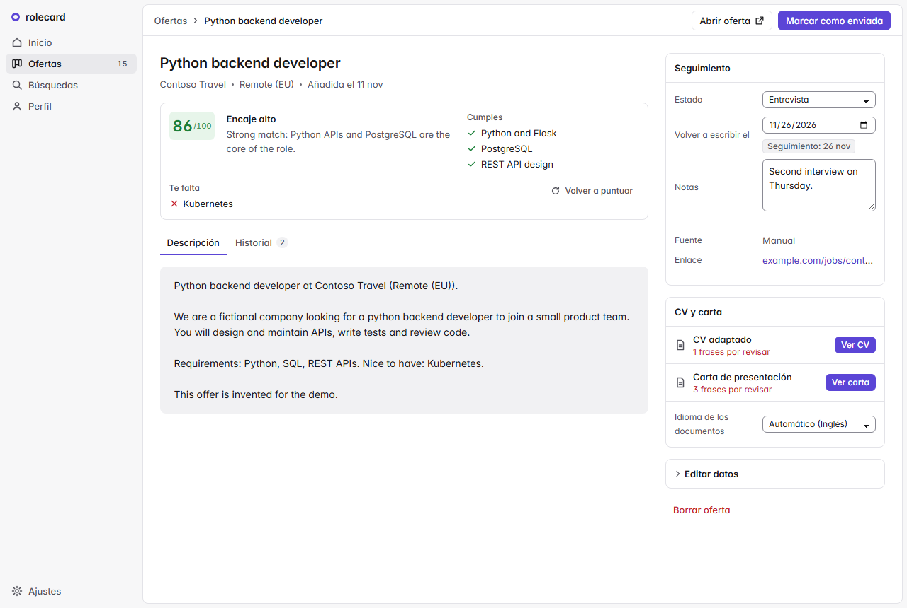

# rolecard

[English](README.md) · [Guía](docs/guide.es.md) · [Usa tu propia IA](docs/ai.es.md)

**No hace falta saber programar: descárgala, haz doble clic y úsala en tu navegador.**
[Guía paso a paso](docs/install.es.md)

Un asistente local y privado para buscar empleo. Subes tu CV una vez, añades ofertas y
rolecard puntúa cuánto encaja cada una contigo y sigue cada candidatura en un tablero.
Para cada oferta prepara un CV y una carta adaptados en los que cada frase muestra el
hecho de tu perfil del que sale; tú los revisas y exportas un PDF a una columna.

## Descargar

1. Instala Python 3.12 o posterior desde [python.org](https://www.python.org/downloads/), una vez.
2. Descarga **[rolecard.zip](https://github.com/nibforge/rolecard/releases/latest/download/rolecard.zip)** y descomprímelo.
3. Haz doble clic en `Iniciar rolecard.bat` (Windows) o `Iniciar rolecard.command`
   (macOS); en Linux, ejecuta `start.sh`. La primera vez se prepara durante unos
   minutos; después rolecard se abre en tu navegador.

La [guía paso a paso](docs/install.es.md) explica cada clic, los avisos de seguridad que
puedes ver, cómo cerrar rolecard y cómo actualizar sin perder tus datos.



> **Estado:** desarrollo temprano (0.1.2). Aún no está publicado en PyPI.

## Principios

- **Te presentas tú.** rolecard nunca envía candidaturas ni rellena formularios de
  portales de empleo. Lo prepara todo; tú pulsas «Abrir oferta» y la envías.
- **Sin scraping.** Las ofertas salen de lo que pegas, o de APIs públicas de empleo
  cuyas condiciones lo permiten.
- **Nada inventado.** Los CV adaptados solo reordenan, priorizan y reformulan hechos de
  tu perfil maestro, y revisas cada documento generado antes de usarlo.
- **Local y privado.** Tus datos viven en una carpeta de tu equipo, el servidor solo
  escucha en `127.0.0.1` y no hay telemetría.

## Para desarrolladores: clonar el repo

Necesita Python 3.12 o posterior.

1. `python -m venv venv`
2. `venv/Scripts/python -m pip install -r requirements.txt` y después
   `venv/Scripts/python -m pip install -e . --no-deps` (Linux/macOS: `venv/bin/`).
3. `venv/Scripts/rolecard` abre `http://127.0.0.1:8765` en tu navegador.

Opciones: `--port N`, `--data-dir RUTA` (o la variable `ROLECARD_HOME`) y
`--no-browser`. Para probarlo con datos ficticios:
`venv/Scripts/python scripts/demo_data.py carpeta-demo --documents` y después
`venv/Scripts/rolecard --data-dir carpeta-demo`. La [guía](docs/guide.es.md) recorre
cada paso.

## Usa tu propia IA

rolecard no tiene un servicio de IA propio: eliges uno en Ajustes. El nivel gratuito de
Gemini, un modelo local con Ollama, Claude Code con tu plan de Claude o una API de pago
por uso. Puntuar 100 ofertas y preparar 10 CV y 10 cartas costó 0,08 $ al precio de pago
de Gemini, y nada en su nivel gratuito: [opciones, configuración, privacidad y mediciones](docs/ai.es.md).

## Privacidad

- Todo se guarda en tu carpeta de datos (por defecto `~/.rolecard`): la base de datos,
  tus ajustes, una clave secreta local y el log.
- No se envía nada a ningún sitio salvo los textos que mandas al proveedor de IA que
  elegiste, y tus palabras de búsqueda a las APIs de empleo que actives. Ajustes te
  avisa cuando el proveedor es un servicio en la nube.
- Los textos del CV y de las ofertas se tratan como no fiables: la IA se ejecuta sin
  herramientas y cada respuesta se comprueba contra un esquema estricto antes de
  guardarla.
- Cuando se rechaza una respuesta de la IA, el log guarda solo el tipo de error, la
  longitud de la respuesta y un hash, nunca su texto, porque podría citar tu CV.

Más en [SECURITY.md](SECURITY.md) y [ARCHITECTURE.md](ARCHITECTURE.md) (en inglés).

## Tests

```
venv/Scripts/python -m pip install -r requirements-dev.txt
venv/Scripts/python -m pytest -q
```

## Cómo se hizo

rolecard se escribió con Claude Code, el agente de programación de Anthropic. Cada
cambio lo especificó, revisó y aceptó el mantenedor, y lleva sus tests: la suite tiene
816 tests automáticos. Antes de la primera versión pública se auditó el código con
gitleaks, pip-audit, bandit, vulture y ruff, más una revisión de seguridad manual; el
resumen está en [SECURITY.md](SECURITY.md#audit).

## Licencia

MIT, ver [LICENSE](LICENSE). Los archivos de terceros incluidos conservan sus licencias:
htmx (BSD Zero Clause) y la tipografía Inter (SIL Open Font License 1.1); los dos avisos
están en el archivo LICENSE.
