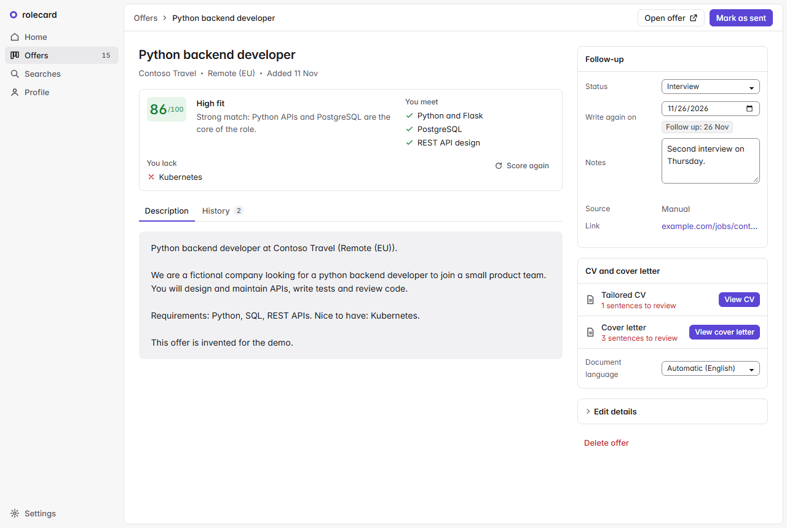

# rolecard

[Español](README.es.md) · [Guide](docs/guide.en.md) · [Use your own AI](docs/ai.en.md)

A local, private assistant for your job search. Upload your CV once, add job offers,
and rolecard scores how well each one fits you and keeps track of every application in
a board. For each offer it prepares a tailored CV and cover letter where every sentence
shows the profile fact it comes from; you review them and export a one-column PDF.



> **Status:** early development (0.1.0). Not yet published on PyPI.

## Principles

- **You apply yourself.** rolecard never submits applications or fills in job-portal
  forms. It prepares everything; you click "Open offer" and send it.
- **No scraping.** Offers come from what you paste, or from public job APIs whose terms
  allow it.
- **Nothing invented.** Tailored CVs only reorder, prioritise and reword facts from your
  master profile, and you review every generated document before using it.
- **Local and private.** Your data lives in a folder on your machine, the server
  listens only on `127.0.0.1`, and there is no telemetry.

## Install

Requires Python 3.12+.

1. `python -m venv venv`
2. `venv/Scripts/python -m pip install -r requirements.txt` and then
   `venv/Scripts/python -m pip install -e . --no-deps` (Linux/macOS: `venv/bin/`).
3. `venv/Scripts/rolecard` opens `http://127.0.0.1:8765` in your browser.

Options: `--port N`, `--data-dir PATH` (or the `ROLECARD_HOME` variable) and
`--no-browser`. To try it with fictional data:
`venv/Scripts/python scripts/demo_data.py demo-folder --documents`, then
`venv/Scripts/rolecard --data-dir demo-folder`. The [guide](docs/guide.en.md) goes
through every step.

## Use your own AI

rolecard has no AI service of its own: you choose one in Settings. Gemini's free tier,
a local model with Ollama, Claude Code with your Claude plan or a pay-per-use API.
Scoring 100 offers and preparing 10 CVs and 10 letters cost $0.08 at Gemini's paid
price, and nothing on its free tier: [options, setup, privacy and measurements](docs/ai.en.md).

## Privacy

- Everything is stored in your data folder (default `~/.rolecard`): the database, your
  settings, a local secret key and the log.
- Nothing is sent anywhere except the texts you send to the AI provider you chose, and
  your search words to the job APIs you turn on. Settings tells you when the provider is
  a cloud service.
- CV and offer texts are treated as untrusted: the AI runs without tools, and every
  answer is checked against a strict schema before it is saved.
- When an AI answer is rejected, the log keeps only the kind of error, the answer's
  length and a hash, never its text, because it could quote your CV.

More in [SECURITY.md](SECURITY.md) and [ARCHITECTURE.md](ARCHITECTURE.md).

## Tests

```
venv/Scripts/python -m pip install -r requirements-dev.txt
venv/Scripts/python -m pytest -q
```

## How this was built

rolecard was written with Claude Code, Anthropic's coding agent. Every change was
specified, reviewed and accepted by the maintainer, and comes with tests: the suite has
778 automated tests. Before the first public release the code was audited with
gitleaks, pip-audit, bandit, vulture and ruff, plus a manual security review; the
summary is in [SECURITY.md](SECURITY.md#audit).

## License

MIT, see [LICENSE](LICENSE). Bundled third-party files keep their own licenses: htmx
(BSD Zero Clause) and the Inter typeface (SIL Open Font License 1.1); both notices are in
the LICENSE file.
