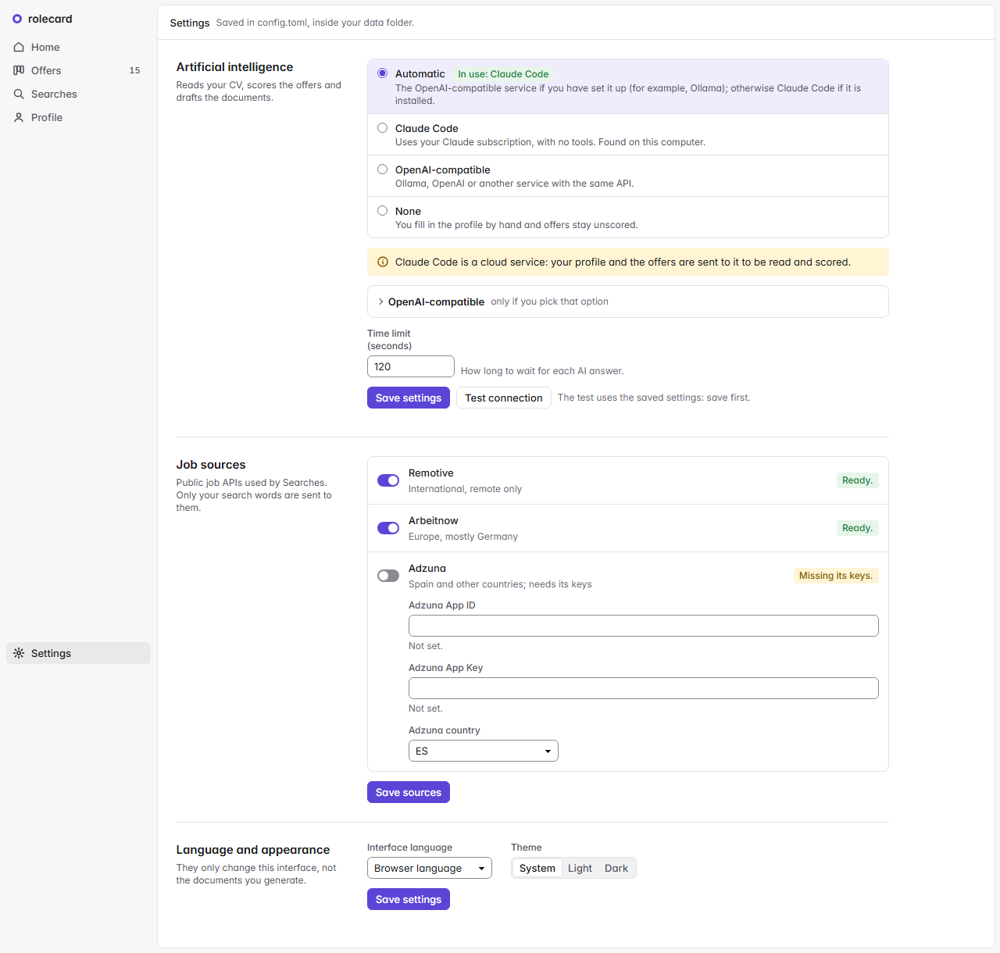
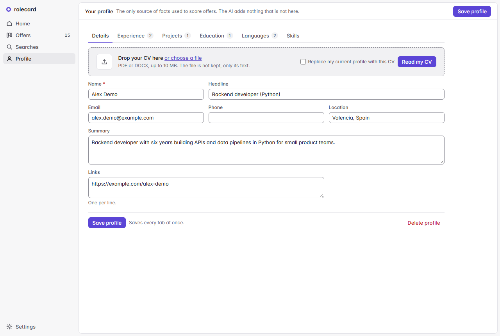
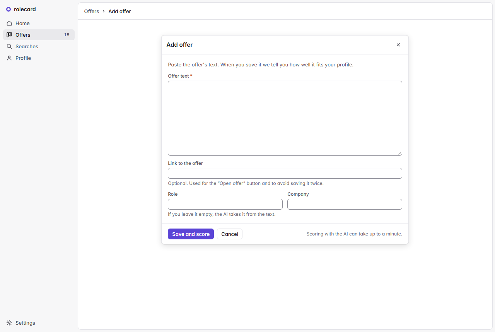
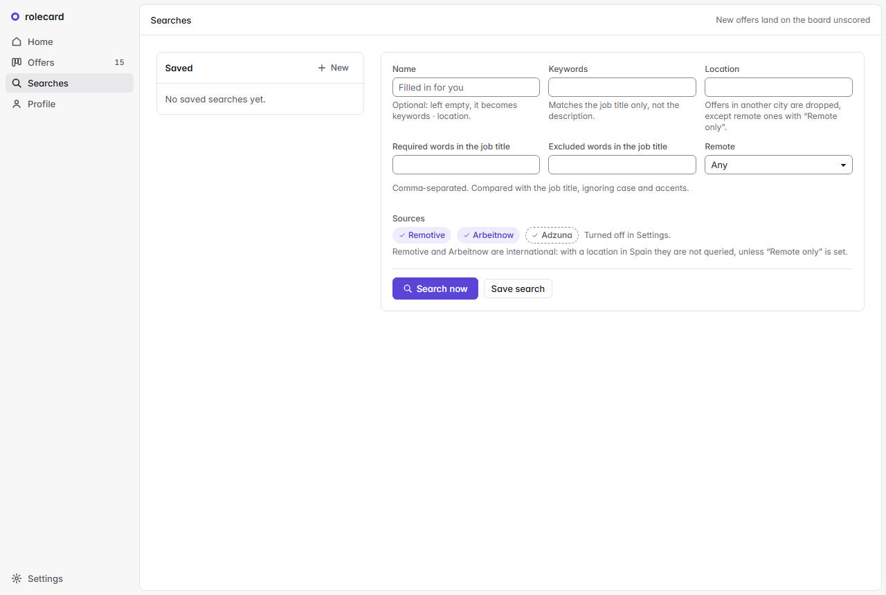
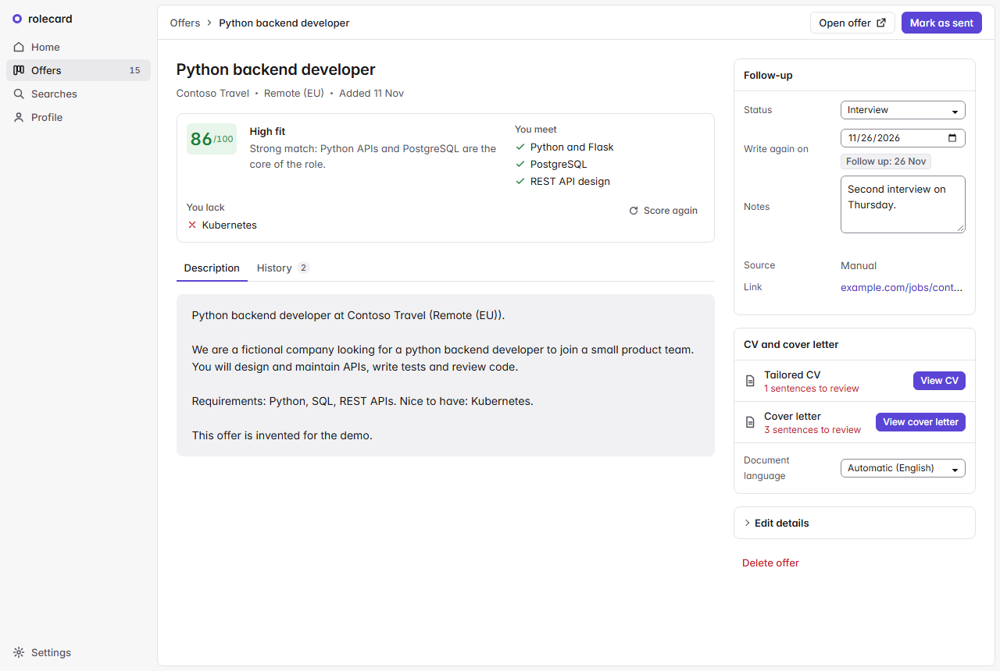
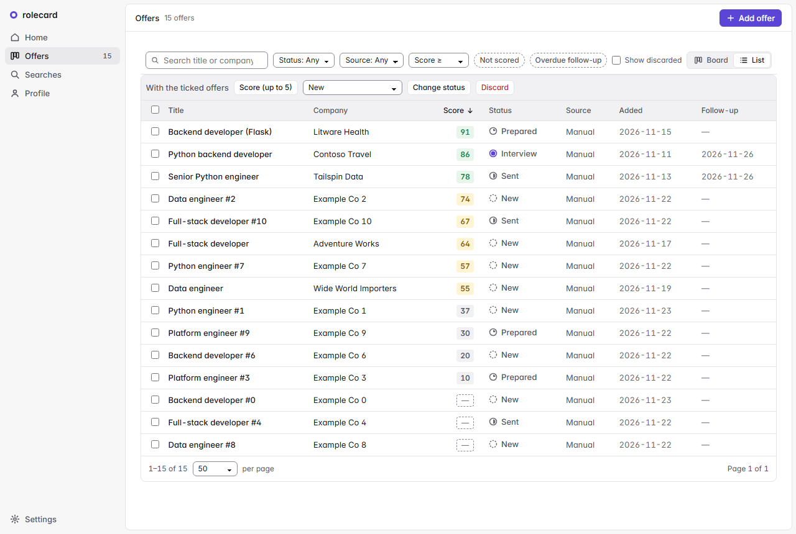
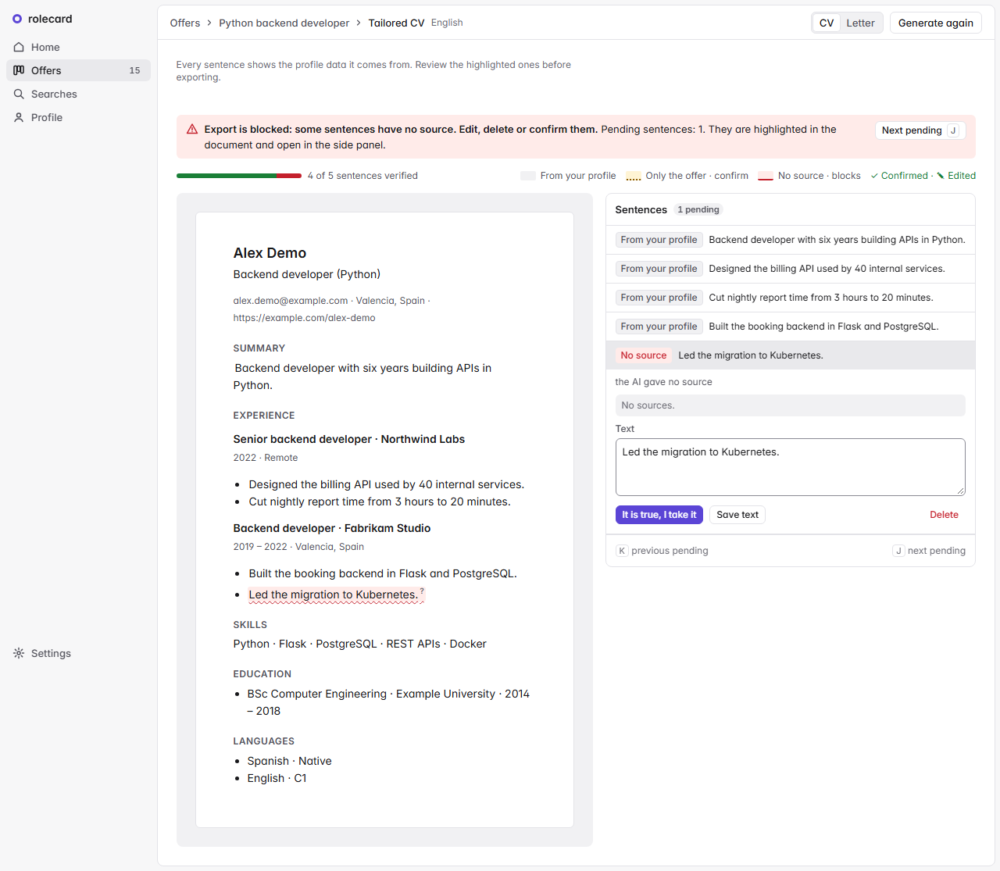
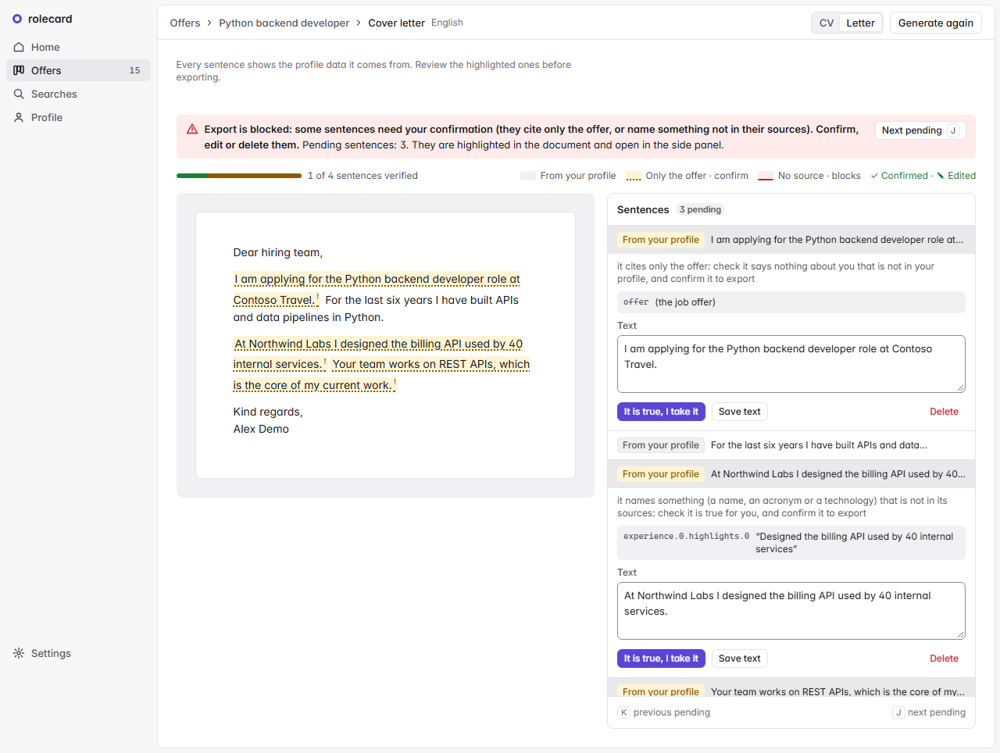
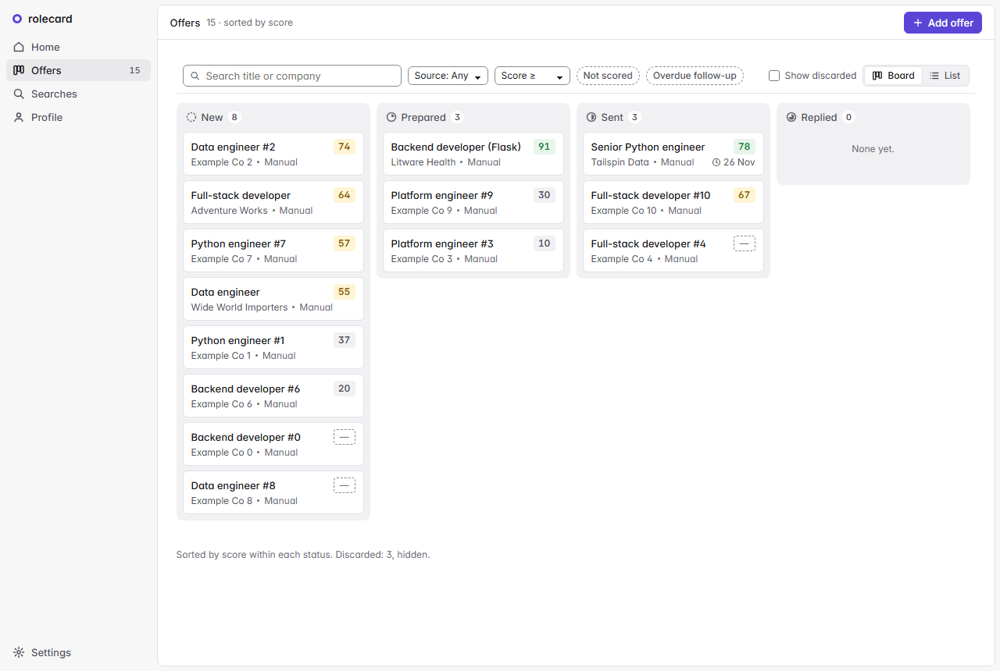
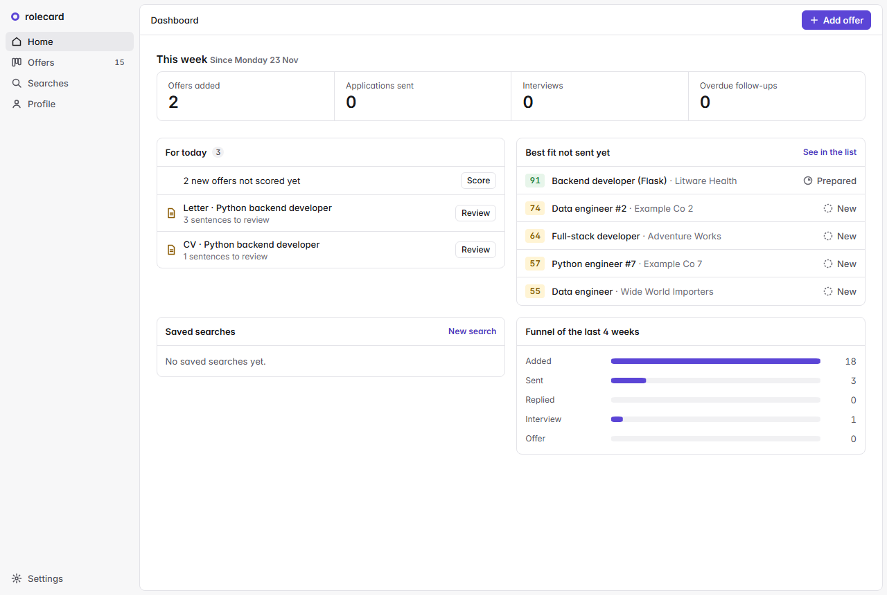

# rolecard guide

[Español](guide.es.md) · [Home](index.md)

This guide walks through rolecard from start to finish: your profile, finding offers,
scoring them, preparing a tailored CV and cover letter, reviewing them sentence by
sentence, exporting them and tracking each application. The screenshots use the
fictional demo data (`scripts/demo_data.py`), never a real CV.

## 1. Install and start

You need Python 3.12 or newer.

```
python -m venv venv
venv/Scripts/python -m pip install -r requirements.txt   # Linux/macOS: venv/bin/
venv/Scripts/python -m pip install -e . --no-deps
venv/Scripts/rolecard
```

rolecard opens `http://127.0.0.1:8765` in your browser. Your data goes to `~/.rolecard`
(change it with `--data-dir PATH` or the `ROLECARD_HOME` variable). To try it with
fictional data first:

```
venv/Scripts/python scripts/demo_data.py demo-folder --documents
venv/Scripts/rolecard --data-dir demo-folder
```

## 2. Choose your AI

Open **Settings**. Under *Artificial intelligence*, pick a provider, press
**Save settings** and then **Test connection**. Settings shows which provider is in use
and warns you when it is a cloud service. The options, what each costs and what each does
with your data are in [Use your own AI](ai.en.md).



## 3. Your profile

Open **Profile**, choose your CV (PDF or DOCX, up to 10 MB) and press **Read my CV**.
The AI turns it into a structured profile: experience, projects, education, languages
and skills. The file itself is not kept, only its text.

Check every field and press **Save profile**. This profile is the only source of facts
for everything rolecard writes, so it is worth getting right.



## 4. Find offers

There are two ways to add offers:

- **Add offer**: paste the text of an offer you found (and its link, if you want
  **Open offer** to take you back to it).
- **Searches**: query public job APIs (Remotive, Arbeitnow and, with its keys, Adzuna)
  with your search words. Only those words are sent to them. You can **Save search** and
  run it again later; offers you already have are not added twice.

rolecard never scrapes websites and never fills in a portal's forms.





## 5. Score

Press **Score** on an offer, or score all the new ones from **Home**. The AI compares
the offer with your profile and gives a score out of 100, a short summary, what you meet
and what is missing.



The **Offers** list sorts and filters them, so you can spend your time on the best few.



## 6. Tailored CV and cover letter

From the offer's page, press **Prepare CV** or **Prepare cover letter**. The AI selects,
orders and rewords facts from your profile for that offer, in the offer's language or the
one you choose. Your name, dates, companies and education are copied from your profile
by code, never written by the AI.

## 7. Review sentence by sentence

Every sentence shows the profile entries it comes from. The side panel lists them all:

- **From your profile**: the sentence cites entries that exist, and every figure in it
  is in those entries.
- **No source**: the AI gave no valid source, or the sentence has a figure that is not
  in its sources. It blocks export.
- **Only the offer · confirm**: a letter sentence that cites only the offer, or a
  sentence that names something not found in its sources. You confirm it if it is true.

For each highlighted sentence you can edit the text, delete it, or press
**It is true, I take it**. If your profile changes later, the sentences whose sources
changed are highlighted again.





The check is literal: it catches a missing name or number, not a false claim made in
ordinary words. That is why you read every document before using it.

## 8. Export

Export stays blocked until no sentence is pending and you press **Mark as reviewed**.
Then you have:

- **Download PDF**: one column, real text, readable by applicant tracking systems.
- **Print view**: for your browser's "Save as PDF".
- **Copy text**: the letter, to paste into an email or a form.

Reviewing the CV moves a new offer to *Prepared*. rolecard never sends anything: you
press **Open offer** and apply yourself, on the original site.

## 9. Track your applications

The **Board** has one column per status: New, Prepared, Sent, Replied, Interview, Offer
and Discarded. Move an offer as its application progresses, add notes, and set a date in
**Write again on**. **Home** shows what is due today, the best-fitting offers you have not
sent yet and your progress over the last four weeks.





## Where your data is

Everything is in your data folder: the database, `config.toml`, a local secret key and
the log. Back it up by copying the folder while rolecard is closed. More in
[SECURITY.md](https://github.com/nibforge/rolecard/blob/main/SECURITY.md).
