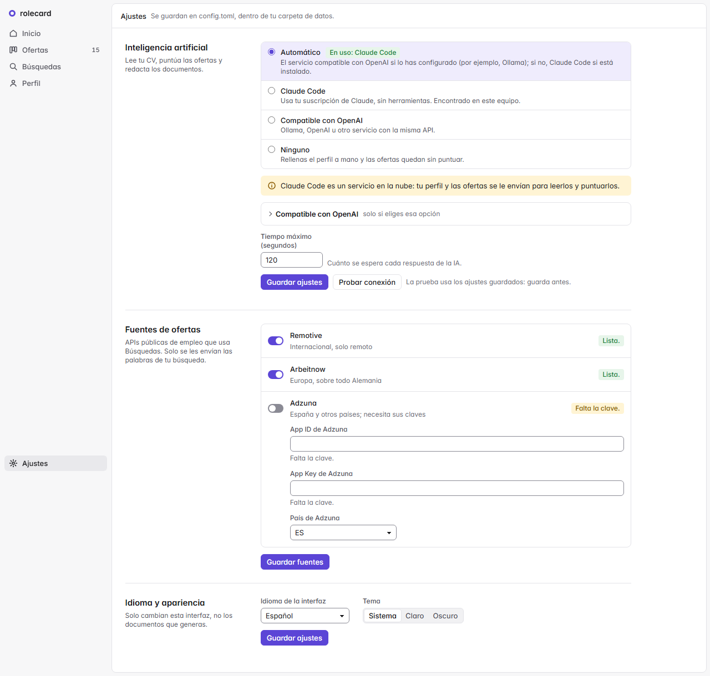
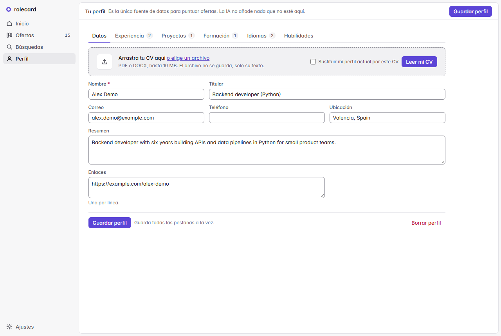
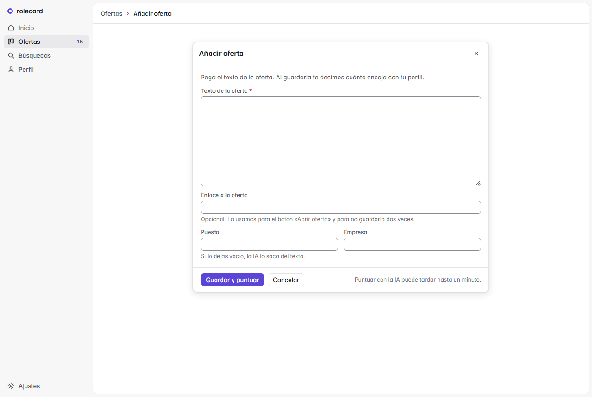
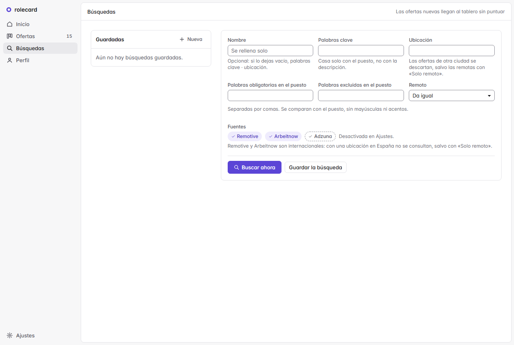
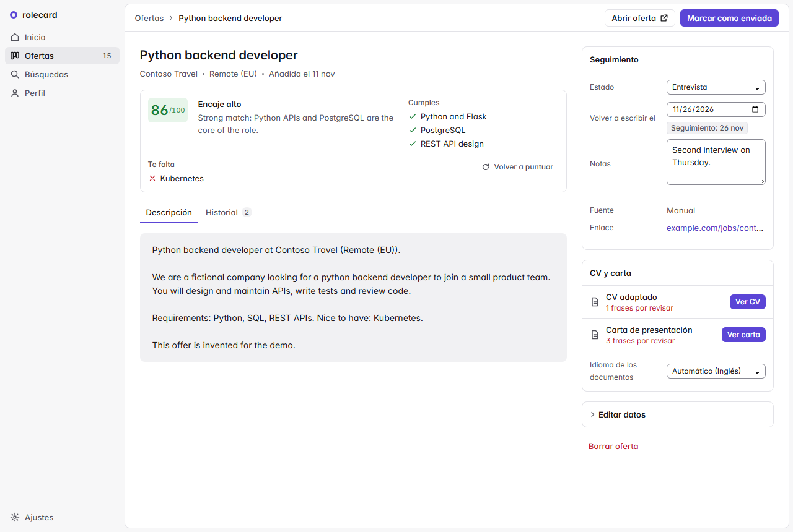
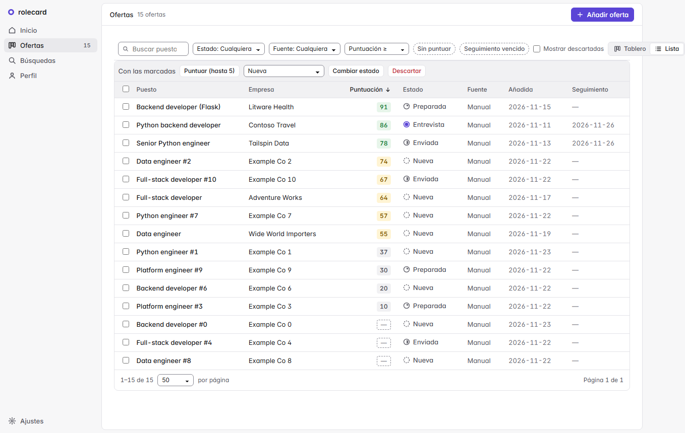
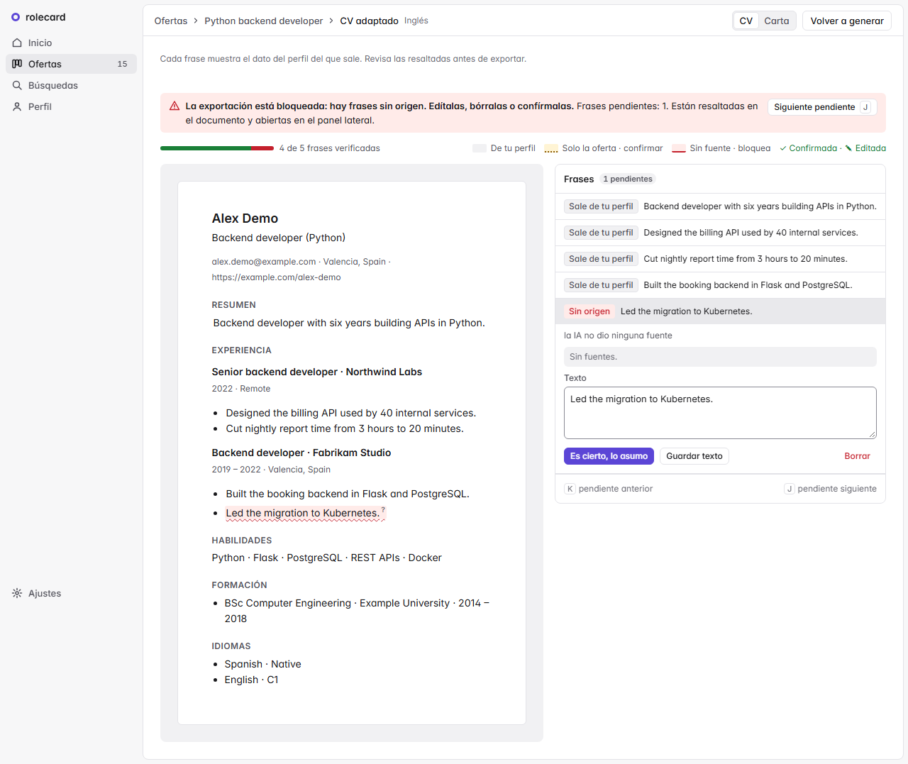
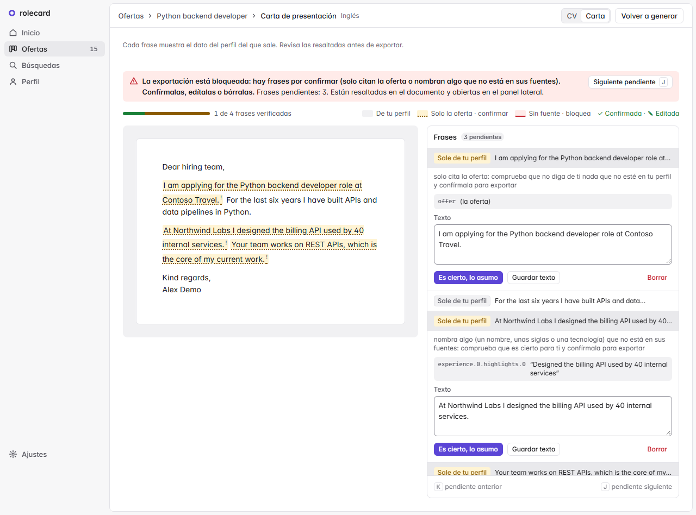
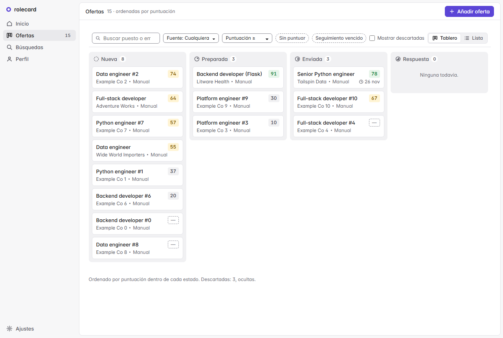
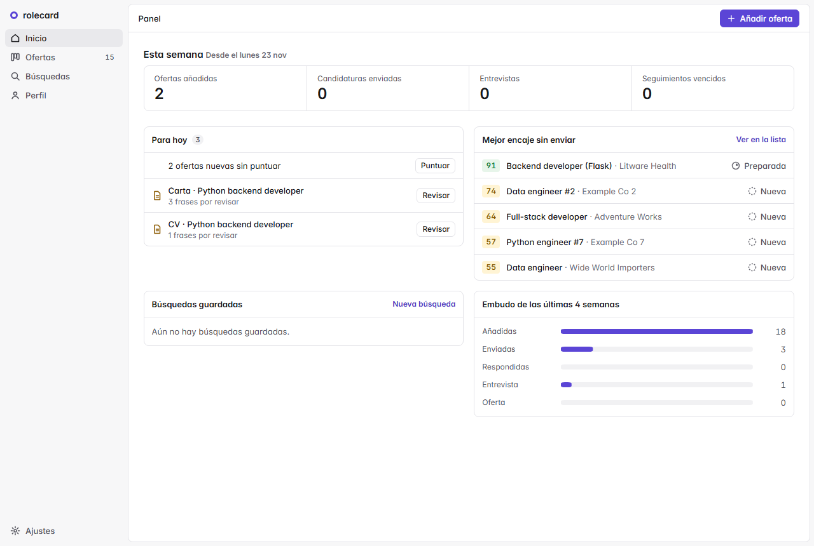

# Guía de rolecard

[English](guide.en.md) · [Inicio](index.md)

Esta guía recorre rolecard de principio a fin: tu perfil, encontrar ofertas, puntuarlas,
preparar un CV y una carta adaptados, revisarlos frase a frase, exportarlos y seguir cada
candidatura. Las capturas usan los datos ficticios de demostración
(`scripts/demo_data.py`), nunca un CV real.

## 1. Instalar y arrancar

Necesitas Python 3.12 o posterior.

```
python -m venv venv
venv/Scripts/python -m pip install -r requirements.txt   # Linux/macOS: venv/bin/
venv/Scripts/python -m pip install -e . --no-deps
venv/Scripts/rolecard
```

rolecard abre `http://127.0.0.1:8765` en tu navegador. Tus datos van a `~/.rolecard`
(se cambia con `--data-dir RUTA` o la variable `ROLECARD_HOME`). Para probarlo antes con
datos ficticios:

```
venv/Scripts/python scripts/demo_data.py carpeta-demo --documents
venv/Scripts/rolecard --data-dir carpeta-demo
```

## 2. Elige tu IA

Abre **Ajustes**. En *Inteligencia artificial*, elige un proveedor, pulsa
**Guardar ajustes** y después **Probar conexión**. Ajustes muestra qué proveedor está en
uso y te avisa cuando es un servicio en la nube. Las opciones, cuánto cuesta cada una y
qué hace cada una con tus datos están en [Usa tu propia IA](ai.es.md).



## 3. Tu perfil

Abre **Perfil**, elige tu CV (PDF o DOCX, hasta 10 MB) y pulsa **Leer mi CV**. La IA lo
convierte en un perfil estructurado: experiencia, proyectos, formación, idiomas y
habilidades. El archivo no se guarda, solo su texto.

Revisa cada campo y pulsa **Guardar perfil**. Este perfil es la única fuente de hechos de
todo lo que escribe rolecard: merece la pena dejarlo bien.



## 4. Encuentra ofertas

Hay dos formas de añadir ofertas:

- **Añadir oferta**: pega el texto de una oferta que hayas encontrado (y su enlace, si
  quieres que **Abrir oferta** te lleve de vuelta a ella).
- **Búsquedas**: consulta APIs públicas de empleo (Remotive, Arbeitnow y, con sus
  claves, Adzuna) con tus palabras de búsqueda. Solo se les envían esas palabras. Puedes
  **Guardar la búsqueda** y repetirla más tarde; las ofertas que ya tienes no se añaden
  dos veces.

rolecard nunca hace scraping de webs ni rellena los formularios de un portal.





## 5. Puntúa

Pulsa **Puntuar** en una oferta, o puntúa todas las nuevas desde **Inicio**. La IA
compara la oferta con tu perfil y da una puntuación sobre 100, un resumen corto, lo que
cumples y lo que falta.



La lista de **Ofertas** las ordena y las filtra, para que dediques tu tiempo a las mejores.



## 6. CV y carta adaptados

Desde la página de la oferta, pulsa **Preparar CV** o **Preparar carta**. La IA elige,
ordena y redacta hechos de tu perfil para esa oferta, en el idioma de la oferta o en el
que elijas. Tu nombre, las fechas, las empresas y la formación los copia el código desde
tu perfil; la IA no los escribe nunca.

## 7. Revisa frase a frase

Cada frase muestra de qué entradas del perfil sale. El panel lateral las lista todas:

- **De tu perfil**: la frase cita entradas que existen, y cada cifra que lleva está en
  esas entradas.
- **Sin fuente**: la IA no dio una fuente válida, o la frase lleva una cifra que no está
  en sus fuentes. Bloquea la exportación.
- **Solo la oferta · confirmar**: una frase de la carta que cita solo la oferta, o una
  frase que nombra algo que no está en sus fuentes. La confirmas si es cierta.

En cada frase marcada puedes editar el texto, borrarla o pulsar **Es cierto, lo asumo**.
Si tu perfil cambia después, las frases cuyas fuentes han cambiado se vuelven a marcar.





La comprobación es literal: detecta un nombre o una cifra que falta, no una afirmación
falsa dicha con palabras normales. Por eso lees cada documento antes de usarlo.

## 8. Exporta

La exportación sigue bloqueada hasta que no queda ninguna frase pendiente y pulsas
**Marcar como revisado**. Entonces tienes:

- **Descargar PDF**: a una columna, con texto real, legible por los sistemas de
  selección automática (ATS).
- **Vista de impresión**: para el «Guardar como PDF» del navegador.
- **Copiar texto**: la carta, para pegarla en un correo o un formulario.

Revisar el CV pasa una oferta nueva a *Preparada*. rolecard nunca envía nada: pulsas
**Abrir oferta** y te presentas tú, en la web original.

## 9. Sigue tus candidaturas

El **Tablero** tiene una columna por estado: Nueva, Preparada, Enviada, Respuesta,
Entrevista, Oferta y Descartada. Mueve cada oferta según avanza la candidatura, añade
notas y pon una fecha en **Volver a escribir el**. **Inicio** muestra lo que toca hoy,
las ofertas que mejor encajan y aún no has enviado, y tu avance de las últimas cuatro
semanas.





## Dónde están tus datos

Todo está en tu carpeta de datos: la base de datos, `config.toml`, una clave secreta
local y el log. Para hacer una copia, copia la carpeta con rolecard cerrado. Más en
[SECURITY.md](https://github.com/nibforge/rolecard/blob/main/SECURITY.md).
