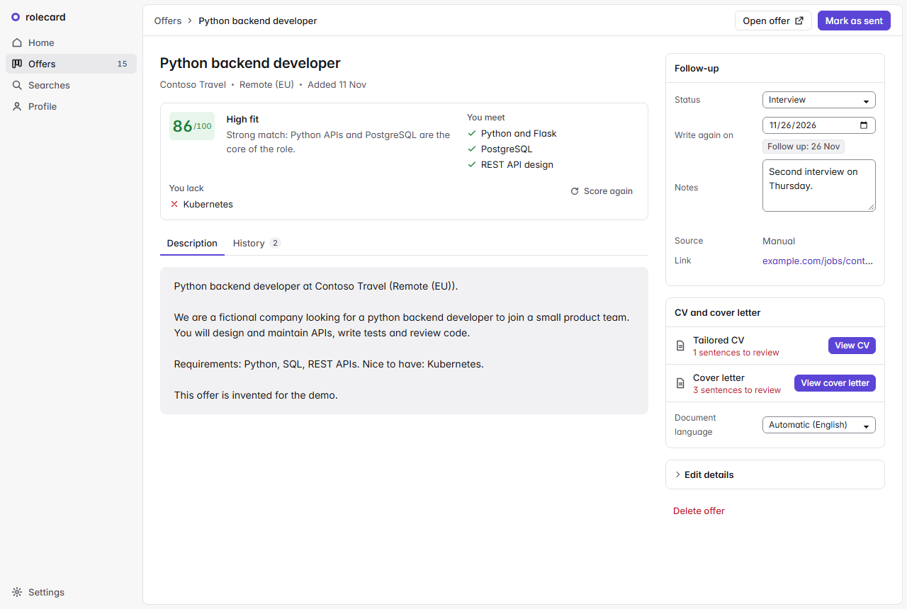

# rolecard

A local, private assistant for your job search: a few applications, done well, reviewed
by you.
Un asistente local y privado para buscar empleo: pocas candidaturas, bien hechas y
revisadas por ti.

**No coding needed: download it, double-click, and use it in your browser.**
**No hace falta saber programar: descárgala, haz doble clic y úsala en tu navegador.**

### [⬇ Download rolecard · Descargar rolecard](https://github.com/nibforge/rolecard/releases/latest/download/rolecard.zip)

Python 3.12+ required, installed once · Necesita Python 3.12+, se instala una vez:
[step-by-step guide](install.en.md) · [guía paso a paso](install.es.md)

| English | Español |
|---|---|
| [Guide: from your CV to your applications](guide.en.md) | [Guía: de tu CV a tus candidaturas](guide.es.md) |
| [Use your own AI](ai.en.md) | [Usa tu propia IA](ai.es.md) |
| [Source code](https://github.com/nibforge/rolecard) | [Código fuente](https://github.com/nibforge/rolecard) |
